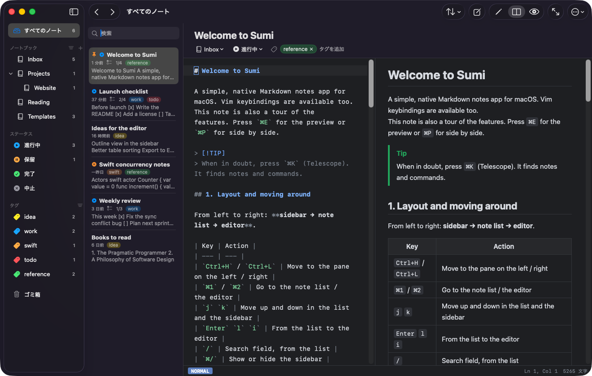
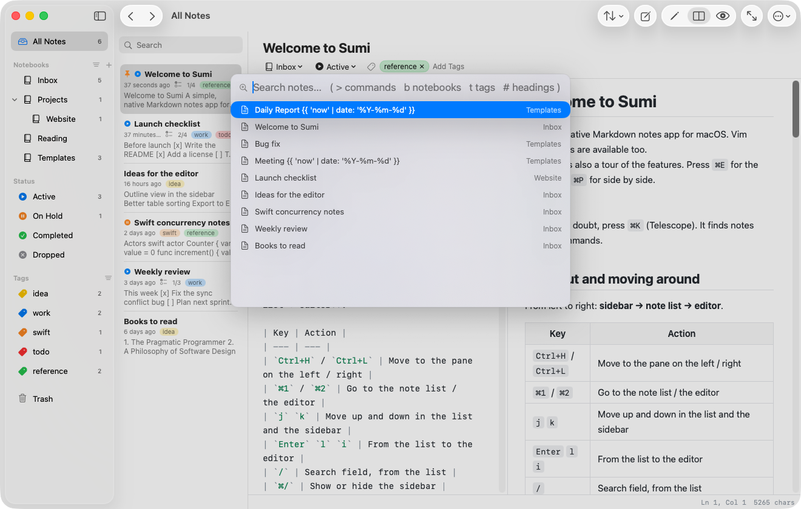
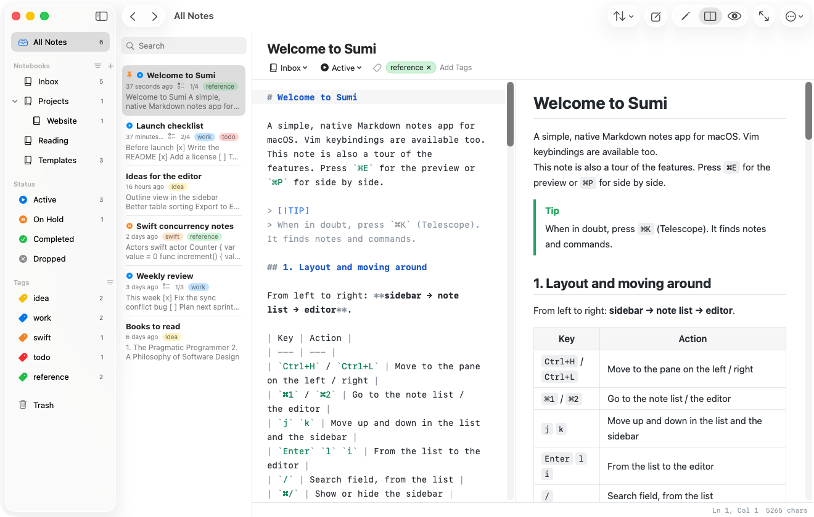

# Sumi

シンプルな macOS ネイティブの Markdown ノートアプリです。Vim キーバインド、Mac 上で動く AI、iCloud 同期に対応しています。

[English README](README.md)



## 特長

- **Markdown エディタとライブプレビュー** — 左右分割、プレビューのみ、集中モード。表、タスクリスト、コードのハイライト、数式（KaTeX）、Mermaid の図、アラート、脚注、絵文字に対応。
- **Vim キーバインド**（任意） — モーション、テキストオブジェクト、レジスタ、マクロ、検索、`:` コマンド。vimrc に独自のマッピングを書けます。ノーマルモードに戻ると日本語入力が自動で英数に切り替わります。
- **整理** — 入れ子にできるノートブック、色付きのタグ、ステータス（進行中・保留・完了・中止）、ピン留め、複数選択。
- **すばやく探す** — `⌘K` の Telescope から、ノート・ノートブック・タグ・見出し・コマンドへ移動。検索では `tag:work`、`status:active`、`"完全一致"` などの絞り込みが使えます。
- **ノートリンクとバックリンク** — `[[` で別のノートへリンク。リンクされた側にはリンク元が表示されます。
- **表の編集** — `Tab` でセルを移動すると表が自動で整形されます。行・列の追加、移動、揃えはツールバーから。
- **Mac 上で動く AI** — 要約、推敲、誤字修正、翻訳、タイトル案・タグ案、ノートへの質問、入力中の提案（任意）。Apple Intelligence を使うので、ノートの内容は Mac の外に出ません。
- **iCloud 同期** — ノートを iCloud Drive に置いて、複数の Mac で共有できます。
- **変更履歴**、**テンプレート**、どのアプリからでも呼び出せる**クイックノート**、ファイルの添付、Markdown / HTML / PDF への書き出し。
- **カスタマイズ** — エディタのテーマ、独自の CSS、キーの割り当て（`keymap.json`）、JavaScript のプラグイン。
- 画面の言語は**日本語と英語**から選べます。

| Telescope | ライト表示・英語 |
| --- | --- |
|  |  |

## 動作環境

- macOS 14 以降
- AI 機能には、Apple Intelligence に対応した Mac と macOS 26 以降が必要です。それ以外の機能は AI なしで使えます。

## ダウンロード

[最新のリリース](https://github.com/ik0326/sumi/releases/latest) から `Sumi-x.y.z.zip` をダウンロードして展開し、**Sumi** を「アプリケーション」フォルダに移動します。Apple シリコンと Intel のどちらの Mac でも動きます。

まだ Apple の公証を受けていないため、初めて開くときに macOS が起動を止めます。次の手順で許可してください。

1. Sumi を一度開き、警告を閉じます。
2. **システム設定 › プライバシーとセキュリティ** を開いて下へスクロールし、Sumi についての表示の横にある **このまま開く** をクリックします。

ターミナルでダウンロードの印を外す方法もあります。

```sh
xattr -dr com.apple.quarantine /Applications/Sumi.app
```

## ソースからビルドする

Xcode と [XcodeGen](https://github.com/yonaskolb/XcodeGen) が必要です。

```sh
brew install xcodegen
git clone https://github.com/ik0326/sumi.git
cd sumi
xcodegen generate
xcodebuild -project Sumi.xcodeproj -scheme Sumi -configuration Release -derivedDataPath build build
open build/Build/Products/Release/Sumi.app
```

エディタ部分のビルド結果は `Sumi/Resources/editor` に含まれています。Node.js が必要になるのは `web/` のコードを変更するときだけです。

```sh
cd web
npm install
npm run build      # Sumi/Resources/editor を作り直す
npm run notices    # THIRD_PARTY_NOTICES.md を作り直す
```

## はじめに

初回起動時に、機能を一通り紹介するノート「Sumi へようこそ」が作られます。まずは次のキーから。

| キー | 動作 |
| --- | --- |
| `⌘N` | 新規ノート |
| `⌘K` | Telescope（ノート、コマンド、ノートブック、タグを探す） |
| `⌘E` / `⌘P` | プレビュー / 左右分割 |
| `⌘⇧D` | 集中モード |
| `⌘J` | ノートの操作 |
| `⌘⇧A` | AI の操作 |
| `⌘,` | 設定（言語、Vim、テーマ、同期、キー、プラグイン） |

## ノートの保存場所

ノートは Markdown を含む JSON ファイルとして保存されます。

- この Mac だけに保存する場合：`~/Library/Application Support/Sumi/`
- iCloud 同期をオンにした場合：`iCloud Drive/Sumi/`

キーの割り当て、独自の CSS、プラグインは Mac ごとに `~/Library/Application Support/Sumi/` に保存されます。

## ライセンス

Sumi は [MIT ライセンス](LICENSE) で公開しています。

CodeMirror、markdown-it、KaTeX、Mermaid、highlight.js、DOMPurify などのオープンソースソフトウェアを含みます。一覧とライセンス全文は [THIRD_PARTY_NOTICES.md](THIRD_PARTY_NOTICES.md) にあります。
