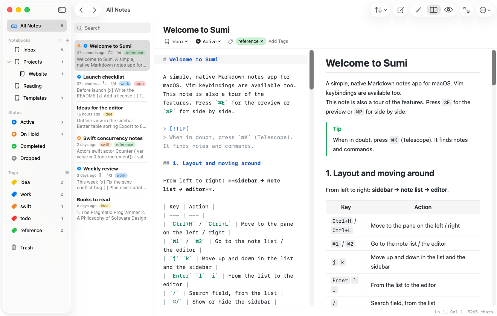
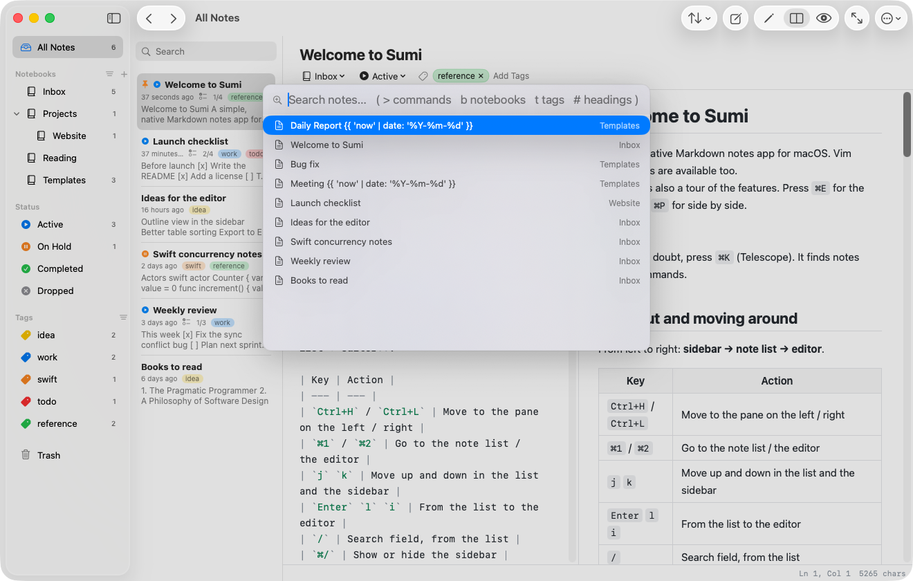
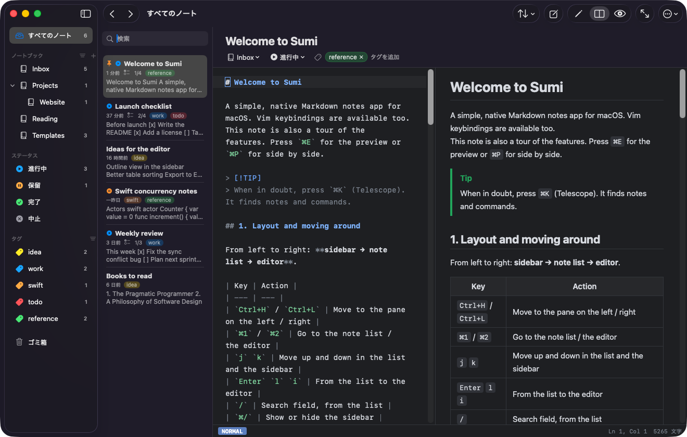

# Sumi

A simple, native Markdown notes app for macOS — with Vim keybindings, on-device AI and iCloud sync.

[日本語の README はこちら](README.ja.md)



## Features

- **Markdown editor with live preview** — side by side, preview only, or distraction free. Tables, task lists, code highlighting, math (KaTeX), Mermaid diagrams, alerts, footnotes and emoji.
- **Vim keybindings** (optional) — motions, text objects, registers, macros, search and `:` commands, plus your own mappings in a vimrc. The input source switches back to ASCII when you return to normal mode.
- **Organize** — nested notebooks, tags with colors, note status (Active, On Hold, Completed, Dropped), pinning, and multiple selection.
- **Find anything** — `⌘K` opens Telescope to jump to notes, notebooks, tags, headings and commands. Search supports qualifiers such as `tag:work`, `status:active` and `"exact phrase"`.
- **Note links and backlinks** — type `[[` to link to another note; linked notes show where they are referenced.
- **Table editing** — `Tab` moves between cells and formats the table; a toolbar adds, moves and aligns rows and columns.
- **On-device AI** — summarize, improve, proofread, translate, suggest titles and tags, ask questions about a note, and optional suggestions while typing. Uses Apple Intelligence, so note text stays on your Mac.
- **iCloud sync** — keep notes in iCloud Drive and share them between your Macs.
- **Revision history**, **templates**, **Quick Note** window with a global shortcut, attachments, and export to Markdown, HTML and PDF.
- **Customizable** — editor themes, your own CSS, key bindings (`keymap.json`) and JavaScript plugins.
- **English and Japanese** interface.

| Telescope | Dark appearance, Japanese interface |
| --- | --- |
|  |  |

## Requirements

- macOS 14 or later
- AI features need macOS 26 or later on a Mac that supports Apple Intelligence. Everything else works without it.

## Build from source

There is no prebuilt download yet. You need Xcode and [XcodeGen](https://github.com/yonaskolb/XcodeGen).

```sh
brew install xcodegen
git clone <this repository>
cd sumi
xcodegen generate
xcodebuild -project Sumi.xcodeproj -scheme Sumi -configuration Release -derivedDataPath build build
open build/Build/Products/Release/Sumi.app
```

The editor's web bundle is checked in under `Sumi/Resources/editor`, so Node.js is only needed if you change the code in `web/`:

```sh
cd web
npm install
npm run build      # rebuilds Sumi/Resources/editor
npm run notices    # regenerates THIRD_PARTY_NOTICES.md
```

## Getting started

The first launch creates a **Welcome to Sumi** note that walks through the features. A few keys to begin with:

| Key | Action |
| --- | --- |
| `⌘N` | New note |
| `⌘K` | Telescope: find notes, commands, notebooks and tags |
| `⌘E` / `⌘P` | Preview / side by side |
| `⌘⇧D` | Distraction free |
| `⌘J` | Note actions |
| `⌘⇧A` | AI actions |
| `⌘,` | Settings (language, Vim, themes, sync, keys, plugins) |

## Where your notes are stored

Notes are plain JSON files containing Markdown.

- On this Mac only: `~/Library/Application Support/Sumi/`
- With iCloud sync turned on: `iCloud Drive/Sumi/`

Key bindings, custom CSS and plugins are kept per Mac in `~/Library/Application Support/Sumi/`.

## Project layout

| Path | Contents |
| --- | --- |
| `Sumi/` | The SwiftUI app |
| `web/` | The editor and preview (CodeMirror 6, markdown-it), bundled into `Sumi/Resources/editor` |
| `scripts/` | The app icon generator and the Japanese translation table |
| `project.yml` | XcodeGen project definition |

## License

Sumi is released under the [MIT License](LICENSE).

It includes open-source software such as CodeMirror, markdown-it, KaTeX, Mermaid, highlight.js and DOMPurify. See [THIRD_PARTY_NOTICES.md](THIRD_PARTY_NOTICES.md) for the full list and license texts.
